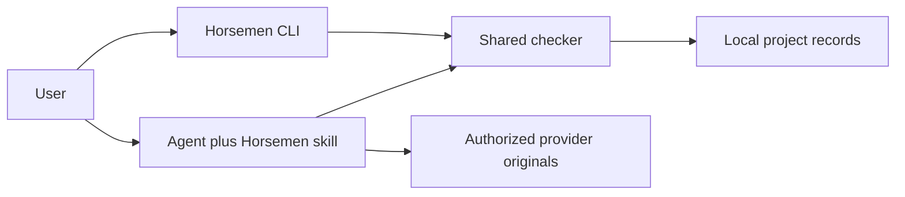
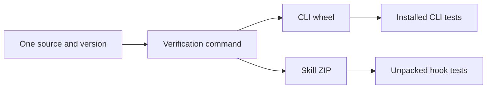

# Tech stack

## Tools

| Tool and version | Why needed | What it needs | How it helps |
| --- | --- | --- | --- |
| Python 3.10+ | Local checks and CLI | Python installation | No runtime package dependencies |
| Git (optional) | Local change context | An existing repository | Adds branch and working-file evidence |
| setuptools 77.0.3 in verification | Build the wheel | Isolated build environment | Packages the shared CLI source |
| unittest and subprocess | Regression checks | Python standard library | Tests real command results and old hooks |
| GitHub Actions | Cross-platform verification | Repository workflow | Tests Linux/macOS with Python 3.10/3.14 |
| Python copytree or an agent skill installer | Copy the skill folder | A new destination or the host installer | Preserves the self-contained skill; direct copying refuses an existing destination |

No web frontend, server, database, hosted service, or background worker.
Provider helpers exist in the skill but have no live account connection by default.

## Runtime connections

## Development and release

See [CONTRIBUTING.md](CONTRIBUTING.md) for reproduction and limits.
