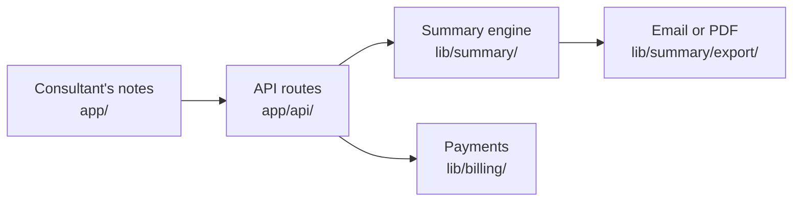

# Examples

Two fictional projects at the intended length. Copy the tone, not the facts.

## Software: Tiny Notes

### VISION.md

```markdown
# Vision

Owner: Mai · Confirmed: 2026-10-20

Every client meeting should end with a clear written record, and the person
who ran the meeting should not lose an evening to write it. Tiny Notes puts
the summary in the client's inbox before the consultant leaves the room.

## Why we exist

Independent consultants spend about an hour after each client meeting
rewriting notes into a summary. Most send it a day late or not at all, and
clients read the delay as a lack of care. The work that matters happened in
the meeting; the write-up only steals time from the next one. The tools to
draft a summary a consultant will sign now exist, so this hour no longer has
to be spent.

## The world we are building

Two thousand consultants send a summary after every meeting, within ten
minutes. Their clients start to expect it and ask other advisors why they do
not do the same. Consultants get their evenings back and look more organized
than firms ten times their size. Tiny Notes pays one person a full salary,
with no outside money, and grows because the summaries themselves travel.

## Who we build for

Solo consultants who bill by the hour and meet 5 to 20 clients a week. They
are the experts in the room, and they work alone. Their clients, small-business
owners, are the second audience: they receive the summaries and judge the
consultant by them.

We do not build for teams or enterprise note-taking. Their buyers want admin
controls and security reviews that would slow the solo product down.

## What we believe

- The consultant approves every summary before it leaves. We draft; they decide.
- One thing worth sending beats a perfect record of everything said.
- Client notes belong to the consultant. They never train shared models.
- A small business that pays for itself is a success, not a stepping stone.

## How we get there

- Now: prove consultants pay and send summaries every week. 20 weekly paying
  consultants by 2027-03-31.
- Next: summaries bring the next users. 200 paying by 2027-12-31, over half
  from referrals.
- Later: a summary after every meeting is the norm in the niche. 2,000
  paying consultants.

## What we will never become

- A team workspace with shared folders and admin roles.
- A tool that sends anything to a client without the consultant's approval.

## How it sustains itself

A 15 USD monthly subscription. Model and hosting costs stay under 3 USD per
user a month. Mai runs it alone, with email support within one working day.

## Bets

- Consultants will pay 15 USD a month. Source: 6 interviews, no price test yet.
- Clients who receive summaries will ask where they come from. Untested.

## Open questions

- Annual plan or monthly only? Mai decides.

## Direction changes

- 2026-10-12: Dropped the team plan. Interviews showed solo use only.
  Previous direction: solo and small-team plans.
```

### PROGRESS.md

```markdown
# Progress

Updated: 2026-10-31 · Stage: beta · Health: At risk

A shorter onboarding flow is underway. Paid plans are built but still wait
for the payment provider. Nothing new shipped on this update day.

Next action: Mai verifies provider approval before a paid launch.

## Latest day

<details open>
<summary>Latest day · 2026-10-31</summary>

## Shipped

- Nothing shipped on this update day.

## Up next

- **PDF export** (target 2026-11-15): Clients receive a file when email is not enough.

## Needs decision

- **Annual plan**: Mai decides whether to offer one before pricing goes live.

## In progress

- **Simpler onboarding** (started 2026-10-31): New users start from a sample meeting.

## Ready to ship

- **Paid plans** (finished 2026-10-29): Release waits for provider approval.

| Item | Evidence |
| --- | --- |
| Simpler onboarding | Design and branch reviewed; next step is a usability check |
| Paid plans | PR reviewed; not deployed; provider approval still missing |

Gate: no paid launch before approval and a verified end-to-end payment.

</details>

## Historical ships

<details>
<summary>Historical ships · newest first</summary>

| Date | Shipped | Proof |
| --- | --- | --- |
| 2026-10-30 | Email export | [Release and production send verification](https://example.org/releases/email-export) |
| 2026-10-12 | Open beta | [Published beta announcement](https://example.org/releases/beta) |

</details>

## Upcoming roadmap

<details>
<summary>Upcoming roadmap</summary>

- Next: invite the first 20 paying consultants after approval.
- Later: calendar import once paid demand is proven.
- Idea: dictation on mobile; not committed.

</details>
```

Proof URLs above are illustrative for this fictional example, not live evidence.

### BRAIN.md

```markdown
# Brain

Brain: Google Drive · Access verified: 2026-10-20

Visibility: private

## Providers

| Role | Provider | Root or project | Access route | Account and scope | Verified |
| --- | --- | --- | --- | --- | --- |
| Brain | Google Drive | drive:Tiny Notes | Drive connector | Mai's personal account | 2026-10-20 |
| Task tracking | GitHub Issues | This repository's issues | `gh` CLI | Mai's GitHub account | 2026-10-20 |

## What lives in the brain

| Knowledge | Provider › location | Why it is not in the repository |
| --- | --- | --- |
| Interviews and research | Drive › Research | Private notes about real people |
| Pricing and sales material | Drive › Business | Spreadsheets and decks that Mai edits |
| Designs and exports | Drive › Design | Large binary files |
| Past discussions with agents | Drive › Decisions log (doc, newest first) | Running notes on what was asked, decided, and why |

## Retrieve

1. Before a product or pricing decision, read the interview summaries in
   Research, then the pricing sheet in Business.
2. When a question may have come up before, search the Decisions log first.
3. Open the original. A summary is a pointer, not proof.

## Save

Setup choices: Mai confirmed Drive, these destinations, and ask-before-write
on 2026-10-20.

| Knowledge | Exact destination | When a new document is allowed |
| --- | --- | --- |
| Decisions and reasons | drive:Tiny Notes/Decisions log, newest first | Update this log; no document per session |
| Interview notes | drive:Tiny Notes/Research | One original per new interview; update the summary sheet |
| Prices | drive:Tiny Notes/Business/Pricing sheet | Update the current sheet |
| Design exports | drive:Tiny Notes/Design | A new approved version |

- Keep lasting changes only; skip a decision already kept at its source.
- To the repository: code, decisions about the code, the project records.
- Never save: chat transcripts, drafts, credentials.
- Agents ask before adding to Drive.

## Cleanup

- Bin: drive:Tiny Notes/bin. Recovery index: drive:Tiny Notes/bin/Index.
- Mai confirmed on 2026-10-20 that agents ask before moving stale copies.
- Preserve unique facts and unresolved questions. The index records the
  original location, replacement, move date, reason, and restore steps.
- Never empty the bin during routine maintenance.

## Access rules

- Mai's personal Google account only, through the Drive connector.

## Access problems

- Moved: search the Tiny Notes folder by title, then fix the location here
  and in STRUCTURE.
- No access: report it. Do not use another account.
```

### STRUCTURE.md

~~~markdown
# Structure

One Next.js app with an API. Research, pricing, and designs live in Google Drive.

## Map

```text
tiny-notes/
├── app/                   pages and UI (start here)
│   ├── layout.tsx         shell for every page
│   └── api/               HTTP handlers, one folder per route
├── lib/
│   ├── summary/           prompting and formatting of summaries
│   │   └── export/        email and PDF export
│   └── billing/           payment-provider client (read its README first)
└── docs/
    └── decisions.md       decisions about the code, with reasons
```

## How it fits together



## Repository

| Key file | Why it matters |
| --- | --- |
| `lib/billing/README.md` | Rules for every payment change |

Commands: `bun install`, `bun dev`, `bun test`.

Where new work goes:

| To add | Put it in |
| --- | --- |
| A new API route | `app/api/<name>/route.ts` |
| An export format | `lib/summary/export/` |

Conventions: UI never calls the payment provider directly; use `lib/billing/`.

## Read before changing

- `lib/billing/README.md` before any change to payments.

## Brain

### Google Drive: drive:Tiny Notes

Open with: the Drive connector, signed in as Mai.

```text
Tiny Notes/
├── Research/          one document per interview, plus a summary sheet (start here)
├── Business/          pricing sheet, pitch deck, beta user list
├── Design/            Figma exports, one folder per release
├── bin/               stale copies; Index records how to restore them
└── Decisions log      lasting decisions and reasons; no task recaps
```

| Document | Location | Use it for |
| --- | --- | --- |
| Interview summary | Research/Summary (sheet) | What consultants said, by theme |
| Pricing model | Business/Pricing (sheet) | Current prices and the cost per user |
| Beta users | Business/Beta users (sheet) | Who to invite and contact |

## Other documents

- README.md: pitch and setup. CHANGELOG.md: what shipped.
~~~

### README.md

```markdown
# Tiny Notes

Tiny Notes turns a solo consultant's meeting notes into a summary the client
can read in minutes. It is for independent consultants who meet many clients
a week and want every meeting to end with a clear written record.

## What it does

Paste meeting notes to get an editable summary. Review the draft, then send
it to the client by email so they have a clear record and next steps.

## What you get

- A draft summary from pasted or typed notes, in your own tone.
- One-click sending of the summary to your client by email.

## Install

Requires Bun 1.1 or later.

1. `bun install`
2. Copy `.env.example` to `.env.local` and add the model key.
3. `bun dev`, then open http://localhost:3000.

## Use

Paste the notes from a meeting, edit the draft, and select **Send**.

## Project records

- [VISION.md](VISION.md): what Tiny Notes becomes and why
- [PROGRESS.md](PROGRESS.md): what shipped, what is left, what comes next
- [BRAIN.md](BRAIN.md): research and business material outside this repository
- [STRUCTURE.md](STRUCTURE.md): map of the code and the Drive folders
- [CHANGELOG.md](CHANGELOG.md): what reached users
```

### CHANGELOG.md

```markdown
# Changelog

## 0.4.0 - 2026-10-30

- Send a summary to your client by email in one click.

## 0.3.0 - 2026-10-12

- Beta opened to ten consultants. Paste notes and get a draft summary.
```

### TECHSTACK.md

````markdown
# Technology and tools

Checked: 2026-10-31 (fictional example).

Research stays in Google Drive so the team can work from the same originals.
This is a partial inventory; unverified stack layers remain unknown.

| Tool and version | Need it addresses | What it needs | How it helps |
| --- | --- | --- | --- |
| Google Drive (plan unknown) | Shared research | An authorized account and the folder in BRAIN | Keeps one original that the team can find and update |

Evidence: BRAIN providers, checked 2026-10-31 in this fictional project.
Reading was checked; writes still follow BRAIN. Plan and storage limits are
unknown. Frontend, backend, data, hosting, testing and developer tools need
verification before this inventory is complete.

Access and permissions: [BRAIN](BRAIN.md). Paths and commands: [STRUCTURE](STRUCTURE.md).
````

## Non-software: Studio pilot (growth experiment)

### VISION.md

```markdown
# Vision

Owner: Hung · Confirmed: 2026-10-05

Wedding photo studios should sell the whole wedding story, not only the
photos. We want every couple a studio shoots to send invitations made from
their own pictures, sold by the studio they already trust.

## Why we exist

Couples already use digital invitations, but studios still resell print.
Studios meet couples months before the wedding and hold their trust, yet
they earn nothing from the invitations. If studios resell digital, one
partner reaches many couples a month, and couples get something that looks
finished on day one.

## The world we are building

Twenty studios in Ho Chi Minh City include the digital package in their
standard bundles and sell it to most couples without help. Studios earn a
margin on every package. New couples find us through studios, not paid ads.

## Who we build for

Mid-size photo studios with 10 to 40 couples a month, and the couples who
book a pre-wedding shoot with them. We do not sell to couples directly until
the studio channel is proven.

## What we believe

- The studio's conversation with the couple is the sales channel. We fit
  into it; we do not replace it.
- A sample made from the studio's own photos sells better than any deck.

## How we get there

- Now: 3 of 10 pitched studios pay for a one-event package by 2027-01-31.
  We stop if fewer than 2 pay after 10 pitches.
- Next: 5 studios resell without Hung in the room, 40 events a month.
- Later: 20 studios, and the studio channel is the main source of couples.

## What we will never become

- A multi-studio dashboard before three studios pay.

## Open questions

- Package price. Hung decides after the first 5 pitches.
```

### PROGRESS.md

```markdown
# Progress

Updated: 2026-11-01 · Stage: building · Health: On track

Five studio pitches are complete. One studio agreed to a paid pilot; the
remaining pitches test two prices. No new delivery happened on this update day.

Next action: Hung pitches studios 6 to 10 by 2026-11-08.

## Latest day

<details open>
<summary>Latest day · 2026-11-01</summary>

## Shipped

- Nothing shipped on this update day.

## Up next

- **First paid pilot event** (target 2026-11-23): Studio A's first couple uses the package.

## Needs decision

- **Package price**: Hung decides after comparing the remaining pitches.

## In progress

- **Pitches 6 to 10** (started 2026-10-28): Complete the evidence for the go/stop decision.

| Item | Evidence |
| --- | --- |
| Pitches 6 to 10 | Pipeline sheet and dated pitch notes; five pitches remain |

</details>

## Historical ships

<details>
<summary>Historical ships · newest first</summary>

| Date | Shipped | Proof |
| --- | --- | --- |
| 2026-10-27 | Pitch deck v2 | [Sent deck and delivery record](https://example.org/studio-pilot/deck-delivery) |

</details>

## Upcoming roadmap

<details>
<summary>Upcoming roadmap</summary>

- Next: decide whether to continue the studio channel in January 2027.
- Idea: a referral fee for introductions; not committed.

</details>
```

The proof URL is illustrative. Real non-Git projects link their authorized
sent deliverable, delivery record or dated owner confirmation, not a fake PR.

### BRAIN.md

```markdown
# Brain

Brain: Google Drive · Access verified: 2026-10-05

Visibility: private

## Providers

| Role | Provider | Root or project | Access route | Account and scope | Verified |
| --- | --- | --- | --- | --- | --- |
| Brain | Google Drive | drive:Studio pilot | `gws` CLI | Hung's personal account | 2026-10-05 |
| Task tracking | Linear | Studio pilot project | Linear connector | Hung's workspace | 2026-10-05 |

## What lives in the brain

| Knowledge | Provider › location | Why it is not in the repository |
| --- | --- | --- |
| Studio pipeline and contacts | Drive › Pipeline sheet | Personal data about studio owners |
| Pitch decks and samples | Drive › Decks | Large files edited in Slides |

## Save

Hung confirmed these destinations and ask-before-write on 2026-10-05.

| Knowledge | Exact destination | When a new document is allowed |
| --- | --- | --- |
| Contacts, replies, and next steps | drive:Studio pilot/Pipeline, the studio's row | Add a row for a new studio; keep one sheet |
| Pitch deck | drive:Studio pilot/Decks/Deck v2 | A distinct version Hung requests |
| Samples | drive:Studio pilot/Samples | A new studio's sample |

Agents ask before writing. Skip task recaps and facts already in the sheet.

## Cleanup

Bin and move permission: Not decided. Keep stale copies in place until
Hung chooses the bin and approves the specific move. Preserve history.
```

### STRUCTURE.md

~~~markdown
# Structure

No code. All working material lives in Google Drive.

## Repository

No code. The repository holds only the project records.

## Brain

### Google Drive: drive:Studio pilot

Open with: `gws drive ls "Studio pilot"`.

```text
Studio pilot/
├── Pipeline           sheet: one row per studio, status and next step (start here)
├── Decks/             pitch decks, one per version
└── Samples/           invitation samples built from studio photos
```

| Document | Location | Use it for |
| --- | --- | --- |
| Pipeline | Pipeline (sheet) | Who was pitched, the outcome, and the next step |
| Deck v2 | Decks/Deck v2 | The current pitch |
~~~

### README.md

```markdown
# Studio pilot

A test of whether wedding photo studios in Ho Chi Minh City will resell a
digital invitation and RSVP package to the couples they shoot.

## What it does

Turn each studio's photos into an invitation sample, show it during the pitch,
and record their response and next step. The pilot tests demand before a
larger rollout; it does not claim that a repeatable sales channel is proven.

## Access

The working material is in Hung's Google Drive. Ask Hung for access; the
folder map is in [STRUCTURE.md](STRUCTURE.md).

## Project records

- [VISION.md](VISION.md): what the studio channel becomes and why
- [PROGRESS.md](PROGRESS.md): pitches, pilots, and the next decision
- [BRAIN.md](BRAIN.md): where the pipeline and decks live
- [STRUCTURE.md](STRUCTURE.md): map of the Drive folders
- [CHANGELOG.md](CHANGELOG.md): what reached studios
```

### CHANGELOG.md

```markdown
# Changelog

## 2026-10-27

- Pitch deck v2 sent to five studios, with invitation samples built from each studio's own photos.
```

### TECHSTACK.md

````markdown
# Technology and tools

Checked: 2026-10-31 (fictional example).

Research stays in Google Drive so the team can work from the same originals.
This is a partial inventory; unverified stack layers remain unknown.

| Tool and version | Need it addresses | What it needs | How it helps |
| --- | --- | --- | --- |
| Google Drive (plan unknown) | Shared research | An authorized account and the folder in BRAIN | Keeps one original that the team can find and update |

Evidence: BRAIN providers, checked 2026-10-31 in this fictional project.
Reading was checked; writes still follow BRAIN. Plan and storage limits are
unknown. Frontend, backend, data, hosting, testing and developer tools need
verification before this inventory is complete.

Access and permissions: [BRAIN](BRAIN.md). Paths and commands: [STRUCTURE](STRUCTURE.md).
````
